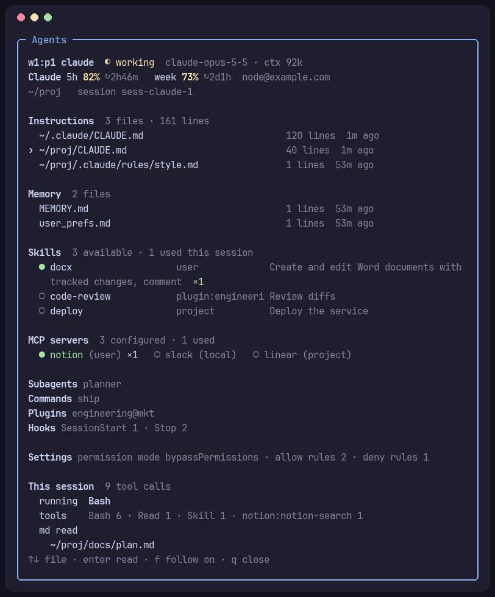
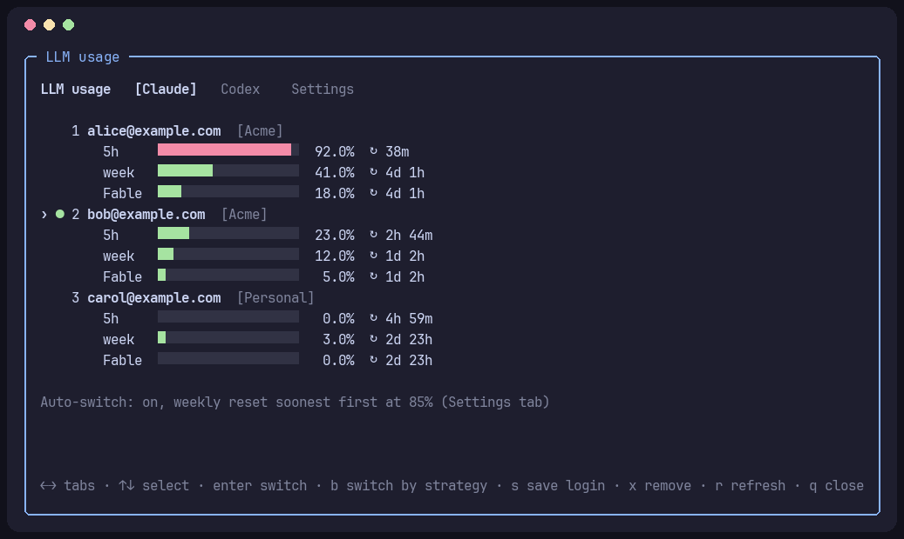
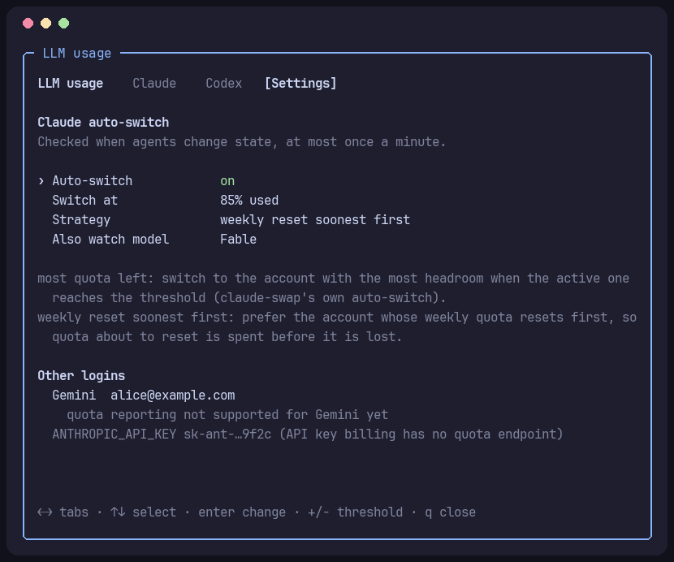

# herdr-llm-usage

A [herdr](https://herdr.dev) plugin for the LLM side of your agents: how much
subscription usage every account has left, switching accounts without losing
running sessions, and what each agent session is set up with and actually uses.

- **Usage**: 5-hour, weekly and per-model usage with reset countdowns, for every
  saved Claude Code and Codex account, in a panel and in the sidebar.
- **Account switching**: Claude switches live, running sessions keep going;
  Codex panes resume the same session on the new login once they are idle.
- **Auto-switch**: Claude moves to another account at a threshold, by most
  quota left or by whichever weekly quota resets soonest.
- **Agent monitor**: a pane beside your work that follows the agent you select
  and shows its instructions, memory, skills, MCP servers, hooks and settings,
  marked with what the session has used, and lets you read those markdown files.



<p>
  
  
</p>

<sub>Screenshots use example accounts and sessions.</sub>

## Install

```bash
herdr plugin install doldola/herdr-llm-usage
```

Update later with `herdr plugin update`. Then add the keys to
`~/.config/herdr/config.toml`:

```toml
[[keys.command]]
key = "prefix+u"
type = "plugin_action"
command = "llm-usage.open"
description = "LLM usage"

[[keys.command]]
key = "prefix+m"
type = "plugin_action"
command = "llm-usage.monitor"
description = "Agent monitor"
```

Keybindings and sidebar rows are read by the herdr client: apply changes with
**menu → reload config** in herdr, or detach and reattach.
`herdr server reload-config` reloads only the server's settings.

### Requirements

| For | You need |
|---|---|
| Everything | `python3` (3.8+, standard library only), Linux or macOS |
| Saving and switching Claude accounts, auto-switch | [claude-swap](https://github.com/realiti4/claude-swap): `uv tool install claude-swap` (or `pipx install claude-swap`). Without it, the Claude tab shows the signed-in account only. |
| Per-pane sessions (Codex resume, agent monitor) | herdr's integrations, so it knows each pane's session id: `herdr integration install claude` and `herdr integration install codex` |
| Codex switching | Codex keeping its login in `auth.json` (the default `cli_auth_credentials_store = "file"`) |

## The panel: `prefix+u`

| Tab | Shows | Keys |
|---|---|---|
| **Claude** | every saved account with 5-hour, weekly and per-model usage | `enter` switch · `b` switch by strategy · `s` save the current login · `x` remove |
| **Codex** | every saved account with its windows | `enter` switch · `b` most quota left · `s` save the current login · `x` remove |
| **Settings** | auto-switch, monitoring and hook options, background activity, other logins (Gemini, API keys) | `enter` change · `+` `-` threshold · `c` run the auto-switch check now |
| **Agents** | every Claude and Codex pane: running tool, context, tool counts, skills, markdown read | `enter` details |

`←` `→`, `Tab` or `1`–`4` change tabs, `↑` `↓` select, `r` refreshes, `q` closes.
Settings live in `config.json` in `herdr plugin config-dir llm-usage`.

### Adding accounts

Each CLI saves whichever account it is signed in to. Save the current one
first, then sign in to the next account and save that too:

| | Sign in | Save |
|---|---|---|
| Claude | `/login` in Claude Code | `s` on the Claude tab |
| Codex | `codex login` | `s` on the Codex tab |

Signing in replaces the login that every running session of that CLI uses.

### Switching

- **Claude**: claude-swap swaps the stored login underneath Claude Code while
  holding Claude Code's own credential locks. Running sessions use the new
  account on their next request (Linux) or within about 30 seconds (macOS
  Keychain cache).
- **Codex**: a running Codex keeps the login it started with, so a switch
  1. saves the current `auth.json` into its account slot (keeping the freshest
     tokens) and writes the chosen login into `auth.json`;
  2. waits for each running Codex pane to be idle (up to three hours), sends
     `/quit`, and runs `codex <original options> resume <session>` in the same
     pane; the original prompt argument is not sent again;
  3. shows a notification for panes it could not restart.

  Saved Codex logins live in `~/.codex/accounts/` (or `$CODEX_HOME/accounts/`),
  readable only by you, like `auth.json`.

## Claude auto-switch

Turn it on in the Settings tab. The active account is checked against the
threshold whenever an agent changes state, at most once a minute:

| Strategy | Behaviour |
|---|---|
| most quota left | claude-swap's own auto-switch: at the threshold, move to the account with the most headroom, with its cooldown and hysteresis |
| weekly reset soonest first | prefer the usable account (every window below the threshold) whose weekly quota resets first, so quota about to reset is spent before it is lost; switch when the active account hits the threshold or another usable one resets over 6 hours sooner, then wait 10 minutes |

**Also watch model** adds a model's weekly window (for example Fable) to the
check. Every switch shows a herdr notification.

**Check while Claude works** adds hooks to Claude Code's `settings.json` that
run `herdr plugin action invoke llm-usage.tick` in the background after tool
calls and at the end of a turn, at most once a minute across all panes, and do
nothing outside herdr. herdr's own hooks run only when an agent changes state,
so a single long turn would otherwise go unchecked. Other hooks and settings
are kept, a backup is saved next to the file once, and turning it off removes
only these hooks. Running Claude sessions pick it up after `/hooks` or a
restart.

**Background activity** in the Settings tab shows when the sidebar update, the
auto-switch check and the monitor last ran and what they did, and the last
hook error.

## Agent monitor: `prefix+m`

Turn on **Agent monitoring** in the Settings tab (off by default), then open
the monitor. It opens to the right of the focused pane and shows the agent you
select in herdr's sidebar, within a second of selecting it:

| Section | Claude | Codex |
|---|---|---|
| Instructions | `CLAUDE.md` chain, `.claude/rules` | `AGENTS.md` chain |
| Memory | the project's memory files | — |
| Skills | user, project and enabled-plugin skills; used ones marked `●` and counted | `~/.codex/skills`, project skills |
| MCP servers | user, local and project (`.mcp.json`) servers; used ones marked | `config.toml` servers |
| Also | subagents, commands, plugins, hooks, permission mode and rule counts | prompts, model, reasoning effort, approval, sandbox |
| This session | running tool, tool counts, markdown files read, model, context | same |

- `↑` `↓` choose a file: an instruction file, rule, memory file, a skill's
  `SKILL.md` or a markdown file the session read; `enter` opens it in a reader
  (`↑` `↓`, `space` / `b` page, `g` / `G`, `esc` back). Long sections fold into
  a "… more" line that `enter` unfolds; `c` folds them back.
- Lines wrap to the pane's width, so a narrow monitor still shows everything.
- When the selected agent is in another tab, the monitor moves into that tab,
  to its right; `f` turns that off. Selecting the monitor itself keeps the
  last agent on screen.
- `r` refreshes, `q` closes and returns focus to the agent.

Setup comes from the files each CLI loads for the session's folder, by their
documented locations: it says what is configured, not that the CLI read it.
The `●` marks come from the session transcript and say what was used.

## Sidebar

Agent panes get tokens you can place in herdr's sidebar rows:

| Token | Example | |
|---|---|---|
| `$usage_5h`, `$usage_week` | `82` | percent used, for color rules |
| `$usage_5h_reset`, `$usage_week_reset` | `↻3h30m`, `↻2d2h` | time to reset |
| `$usage` | `5h 82% ↻3h30m · week 73% ↻2d2h` | both windows in one |
| `$usage_account` | `me@example.com` | signed-in account |
| `$tool` | `Bash`, `notion:notion-search` | running tool, while working (monitoring on) |
| `$skill` | `docx` | last skill used (monitoring on) |
| `$ctx` | `ctx 24%` (Codex), `ctx 92k` (Claude) | context use (monitoring on) |

A layout for a narrow sidebar, with usage colored at 70% and 90%:

```toml
[ui.sidebar.agents]
rows = [
  ["state_icon", "agent", "state_text", { token = "$tool", fg = "#f9e2af", dim = false }],
  [{ token = "$skill", fg = "#cba6f7", dim = false }, { token = "$ctx", fg = "#cdd6f4", dim = false }],
  [{ token = "$usage_5h", fg = "#a6e3a1", bold = true, dim = false, rules = [{ gt = 90, fg = "#f38ba8" }, { gt = 70, fg = "#f9e2af" }] }, { token = "$usage_5h_reset", fg = "#cdd6f4", dim = false }],
  [{ token = "$usage_week", fg = "#a6e3a1", bold = true, dim = false, rules = [{ gt = 90, fg = "#f38ba8" }, { gt = 70, fg = "#f9e2af" }] }, { token = "$usage_week_reset", fg = "#cdd6f4", dim = false }],
  ["workspace", "tab"],
]
```

Custom tokens are dimmed unless the style says `dim = false`, and a row
disappears when none of its tokens has a value (Codex Pro, for example, has no
5-hour window). Tokens refresh on agent state changes, through the Claude hook,
and every few seconds while the monitor or the Agents tab is open.

## Troubleshooting

| Symptom | Check |
|---|---|
| A key does nothing, or is missing from `prefix+?` | apply the config with **menu → reload config** (not `herdr server reload-config`) |
| Sidebar numbers stop changing | Settings → Background activity; turn on **Check while Claude works** for long turns |
| Monitor or Agents tab says "no transcript" or "no session id" | `herdr integration install claude` / `codex` |
| Claude switching is unavailable | install claude-swap; `cswap list` should show your accounts |
| Codex panes did not resume | the notification lists why; panes must run Codex from a shell |

`herdr plugin log list --plugin llm-usage` shows each hook and action run with
its exit code and output.

## Privacy and data

- Everything is read from files on this machine: the CLIs' logins, settings,
  instruction and memory files, and session transcripts. Nothing is sent
  anywhere except the usage requests below.
- Usage comes from the private endpoints the official CLIs use
  (`api.anthropic.com/api/oauth/usage`, `chatgpt.com/backend-api/wham/usage`).
  Tokens are only read; this plugin never refreshes them. claude-swap does its
  own token handling when it switches.
- Transcripts are parsed incrementally, with running totals cached in the
  plugin state directory.

## Notes

- The usage endpoints and transcript formats are not public APIs and may
  change; a part that cannot be read shows why, and the rest keeps working.
- Neither Claude Code nor Codex officially supports multiple accounts; both
  switching paths work with the CLIs' own credential storage.
- The plugin uses the accounts of herdr's environment; `CLAUDE_CONFIG_DIR` and
  `CODEX_HOME` are honored when set there.
- `python3 llm_usage.py status [--json]` prints the signed-in accounts' usage
  from the command line.

## License

[MIT](LICENSE)
