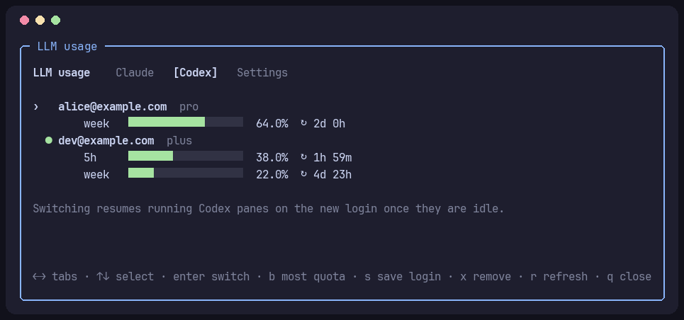

# herdr-llm-usage

A [herdr](https://herdr.dev) plugin that puts your LLM accounts in one panel:
which accounts are signed in, how much subscription usage each has left, and
switching between them without losing running sessions.

| | Shows | Switches |
|---|---|---|
| **Claude Code** | 5-hour, weekly and per-model usage for every saved account | Live, through [claude-swap](https://github.com/realiti4/claude-swap): running sessions keep going and use the new account on their next request (Linux) or within about 30 seconds (macOS Keychain cache). |
| **Codex** | primary/secondary windows and credits for every saved account | Saved logins are swapped into `~/.codex/auth.json`; each running Codex pane is restarted in place once idle, with its original options and `codex resume <session>`. The conversation continues. |
| Gemini CLI, API keys | the signed-in Google account, masked `*_API_KEY`s | — |

Claude can also switch on its own before an account runs out.


<p>
  
  
</p>

<sub>Screenshots use example accounts.</sub>

## Requirements

- `python3` (3.8+, standard library only)
- To save and switch Claude accounts: `uv tool install claude-swap` (or
  `pipx install claude-swap`). Without it, the panel shows the signed-in
  account only.
- To resume Codex panes after a switch: `herdr integration install codex`, so
  herdr knows each pane's session id. Codex must keep its login in `auth.json`
  (the default `cli_auth_credentials_store = "file"`).

## Install

```bash
herdr plugin install doldola/herdr-llm-usage
```

Update later with `herdr plugin update`.

## The panel

```toml
[[keys.command]]
key = "prefix+u"
type = "plugin_action"
command = "llm-usage.open"
description = "LLM usage"
```

| Tab | Keys |
|---|---|
| all | `←` `→` or `Tab` / `1` `2` `3` tabs · `↑` `↓` select · `r` refresh · `q` close |
| Claude | `enter` switch to the selected account · `b` switch by the configured strategy · `s` save the login Claude Code is signed in to · `x` remove |
| Codex | `enter` switch · `b` switch to the account with the most quota · `s` save the current Codex login · `x` remove |
| Settings | `enter` change the selected option · `+` `-` threshold |

Settings are stored in `config.json` in the plugin config directory
(`herdr plugin config-dir llm-usage`).

### Adding accounts

Each CLI saves whichever account it is signed in to. Save the current one
first, then sign in to the next account and save that too:

| | Sign in | Save |
|---|---|---|
| Claude | `/login` in Claude Code | `s` on the Claude tab |
| Codex | `codex login` | `s` on the Codex tab |

Signing in replaces the login every running session of that CLI uses.

### What a Codex switch does

1. Saves the current `auth.json` into its account slot, so the freshest tokens
   are kept, and writes the chosen account's login into `auth.json`.
2. For every Codex pane running at that moment, waits until the agent is idle
   (up to three hours), sends `/quit`, and runs
   `codex <original options> resume <session id>` in the same pane. The
   original prompt argument is not sent again.
3. Shows a notification listing panes it could not restart: no session id
   (install the integration), Codex launched as the pane's own process instead
   of from a shell, or still busy after three hours.

Saved Codex logins live in `$CODEX_HOME/accounts/` (default
`~/.codex/accounts/`), readable only by you, like `auth.json`.

## Claude auto-switch

Turn it on in the Settings tab. On agent status changes, at most once a minute,
the plugin checks the active account against the threshold:

- **most quota left**: claude-swap's own auto-switch; moves to the account with
  the most headroom when the active one reaches the threshold, with
  claude-swap's cooldown and hysteresis.
- **weekly reset soonest first**: prefers the usable account (every window
  below the threshold) whose weekly quota resets first, so quota about to reset
  is spent before it is lost. It switches when the active account reaches the
  threshold, or when another usable account resets more than 6 hours sooner,
  and waits 10 minutes after a switch before considering another.

"Also watch model" adds that model's weekly window (for example Fable) to the
threshold check. Each switch shows a herdr notification.

## Sidebar

Every Claude and Codex agent pane gets these tokens, refreshed on agent
detection and status changes (provider requests are cached for 2 minutes):

| Token | Example |
|---|---|
| `$usage` | `5h 42% ↻2h13m · week 18% ↻3d4h` |
| `$usage_5h` | `42` (percent used, for color rules) |
| `$usage_week` | `18` |
| `$usage_5h_reset` | `↻2h55m` |
| `$usage_week_reset` | `↻5d9h` |
| `$usage_account` | `me@example.com` (the signed-in account) |

For a narrow sidebar, one short row per window with the percentage colored by
how much is used (herdr 0.9.0 or newer). A row disappears when the provider has
no such window (Codex Pro, for example, has only the weekly one).

```toml
[ui.sidebar.agents]
rows = [
  ["state_icon", "agent", "state_text"],
  [{ token = "$usage_5h", fg = "#a6e3a1", bold = true, dim = false, rules = [{ gt = 90, fg = "#f38ba8" }, { gt = 70, fg = "#f9e2af" }] }, { token = "$usage_5h_reset", fg = "#cdd6f4", dim = false }],
  [{ token = "$usage_week", fg = "#a6e3a1", bold = true, dim = false, rules = [{ gt = 90, fg = "#f38ba8" }, { gt = 70, fg = "#f9e2af" }] }, { token = "$usage_week_reset", fg = "#cdd6f4", dim = false }],
  [{ token = "$usage_account", fg = "#89b4fa", dim = false }],
  ["workspace", "tab"],
]
```

Custom tokens are dimmed unless the style says `dim = false`.

## Command line

```bash
python3 llm_usage.py status          # human readable
python3 llm_usage.py status --json   # machine readable
```

## Notes

- The usage endpoints are the private ones the official CLIs use
  (`api.anthropic.com/api/oauth/usage`, `chatgpt.com/backend-api/wham/usage`)
  and may change. Tokens are only read for usage; nothing here refreshes them.
- Neither Claude Code nor Codex officially supports multiple accounts. Both
  switching paths work with the CLIs' own credential storage and may need
  updates when that changes.
- The plugin reads the accounts of herdr's environment; `CLAUDE_CONFIG_DIR` and
  `CODEX_HOME` are honored when set there.
